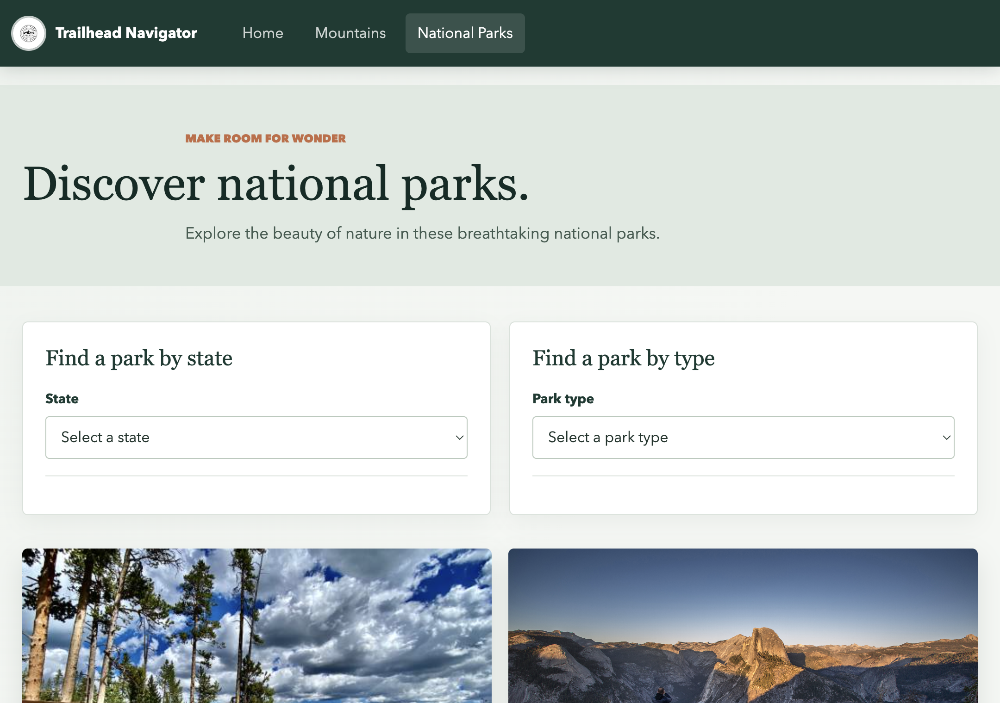
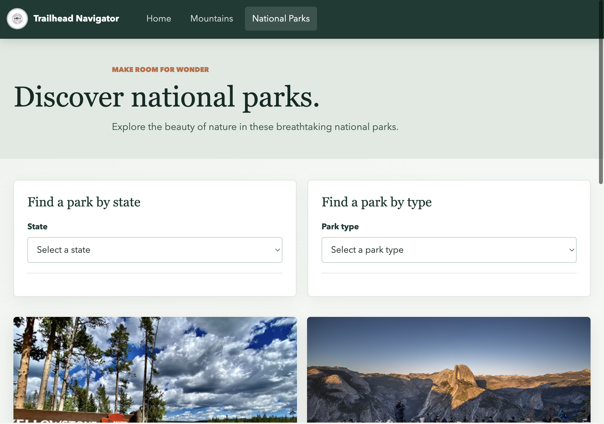

# Trailhead Navigator

Trailhead Navigator helps people explore national parks and mountain destinations through searchable guides and landscape photography.

## Features

- Find national parks by state or park type.
- View park location and contact details, with a link to the official site when available.
- Browse mountain descriptions, elevations, difficulty ratings, and photos.
- Use the responsive layout on desktop and mobile screens.

## Pages

### Home

An overview of the site with links to the park and mountain guides.



### Mountains

Choose a mountain to view its description, elevation, difficulty, and image.


### National Parks

Search for parks by state or park type, then review available location and contact information.



## Built With

- HTML, CSS, and JavaScript
- Bootstrap 5.3

## Run Locally

Open `index.html` in a browser, or start a local server from this directory:

```sh
python3 -m http.server 8000
```

Then open [http://localhost:8000](http://localhost:8000).